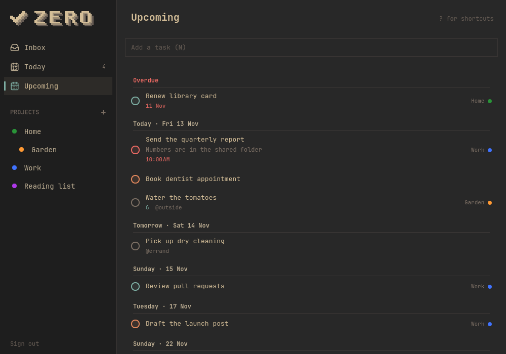

# Zero

Todoist for Omarchy. Today, Upcoming, the Inbox, and every project in one
window you drive from the keyboard, plus a bar widget that shows what's due
today and lets you add to the Inbox without opening anything.



Zero is an unofficial client, not affiliated with or endorsed by Doist, the
makers of Todoist. Todoist and its logo are Doist's trademarks.

## Setup

1. Clone this repo and run `bin/install`. It builds the package and installs
   it with `makepkg -fsi`, so Zero shows up in the app launcher
   (`Super + Space`). Needs `qt6-base`, `qt6-declarative`, and `qt6-wayland`,
   which Omarchy already has.
2. Open Zero and paste your API token from Todoist → Settings →
   Integrations → Developer. It's checked against Todoist, then saved to
   `~/.config/zero/token` (mode 0600). `TODOIST_API_TOKEN` overrides it.
3. For the bar widget, see
   [omarchy-zero](https://github.com/chayotesudado/omarchy-zero):
   `omarchy plugin add https://github.com/chayotesudado/omarchy-zero.git --enable`

Upgrading from Ticked, Zero's old name: the first run moves
`~/.config/ticked/token` over, and the package replaces `ticked`.

## Shortcuts

| Key | Action |
| --- | --- |
| Space | Complete the selected task |
| N | Add a task to the list on screen, into the selected section if there is one (Todoist quick add: dates, `#Project`, `@label`, `p1`) |
| Shift+N | Add a subtask to the selected task |
| Enter | Open the selected task to edit it, or rename the selected section |
| Ctrl+1 … Ctrl+4 | Set the selected task's priority (p1–p4) |
| Ctrl+] / Tab | Indent: make the task a subtask of the one above it |
| Ctrl+[ / Shift+Tab | Outdent: move it out from under its parent |
| Alt+J / Alt+K | Move the selected task (among its siblings) or section down / up |
| M | Move the selected task to another project or section |
| D | Change the selected task's due date (“fri 5pm”, “every monday”, “no date”) |
| T | Make the selected task due today |
| J / ↓, K / ↑ | Next / previous task |
| O | Open the selected task in Todoist |
| Delete | Delete the selected task, or the selected section with its tasks (asks first) |
| S | New section in the project or Inbox on screen |
| 1 / 2 / 3 | Inbox / Today / Upcoming |
| [ / ] | Previous / next list, through every project |
| P | New project |
| C | Change the color of the project on screen |
| Shift+M | Move the project on screen under another, or back to the top level |
| Alt+Shift+J / Alt+Shift+K | Move the project on screen down / up in the sidebar |
| F2 | Rename the project on screen |
| Ctrl+Delete | Delete the project on screen (asks first) |
| R | Refresh |
| Ctrl+Z / Ctrl+Shift+Z | Undo / redo a completion, add, move, date change, edit, rename, indent, reorder or drag, or project move |
| Esc | Leave the add box |
| ? | Show every shortcut |
| Q | Quit |

A new task lands in the list you're looking at: a project view files it
in that project, and Today dates it today. A `#Project` or a date typed in
the text wins. Upcoming and the bar widget add to the Inbox. Hovering a task
(or selecting it) shows Open, Date, and Move buttons too.

Enter (or a double-click, or Open on hover) opens a task: its name and
description to edit, its priority, date, and project, and its subtasks,
which open the same way, with a box to add more. Changes are saved as you
make them, and Esc closes it. Indenting, outdenting, and reordering work in
a project or the Inbox, where Todoist keeps an order; Today and Upcoming are
sorted by date. Tasks and section headings can also be dragged there (a
grip shows on hover): a task takes the level of the task it's dropped in
front of (so dropping between subtasks makes it one), or the top of the
section above. From any list, a task dragged onto the sidebar moves to that
project or the Inbox, or onto Today becomes due today. Projects drag among
their siblings in the sidebar; Shift+M nests them.

A project's sections show as headings in its list, empty ones included,
and new ones are made with S or "+ Add section" at the end of the list.
Select a heading with J/K or a click: N then adds into that section, Enter
renames it, Alt+J/K moves it, and Delete deletes it along with its tasks,
as Todoist does. Deleting a task
asks first and can't be undone, since Todoist has no way to bring it back.

Projects are created with the + beside "Projects" in the sidebar (or P),
with one of Todoist's 20 project colors so it looks the same there, and
renamed, recolored, moved up, down, or under another project, or deleted
from the ⋯ menu that appears on hover (or right-click). Deleting asks first
and says how many tasks and sub-projects go with it, since Todoist deletes
those too and it can't be undone.

Everything is saved to Todoist as you go, so there's never unsaved work.

## Bar widget

[omarchy-zero](https://github.com/chayotesudado/omarchy-zero) puts Todoist's
mark on the Omarchy bar, with what's due today and an add-to-Inbox box in its
popup. It talks to Todoist only through `zero today --json`, `zero add`, and
`zero done`, so it never handles the token.

## Command line

Every command takes `--json`, exits 0 or 1, and writes errors to stderr.

```sh
zero today                      # overdue and due-today tasks
zero list --filter "#Work & p1" # any Todoist filter
zero add "Call the plumber tomorrow 9am"
zero done <task id>
zero status
zero login < token.txt          # sign in without the window
zero logout
zero skill install              # installs a Claude skill for driving it
```

## Development

```sh
bin/build    # build/zero
bin/test     # Qt tests offscreen against a fake Todoist
bin/install  # package and install
```

`ZERO_API_URL` points the app at another server, which the tests use.
